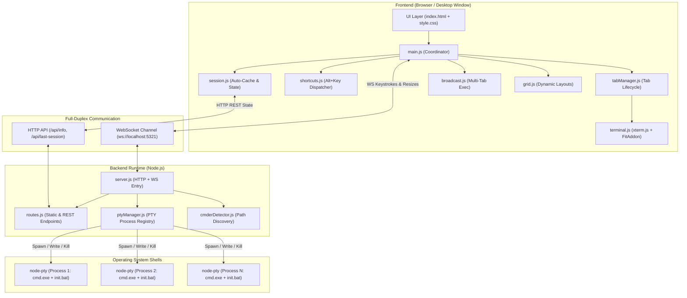
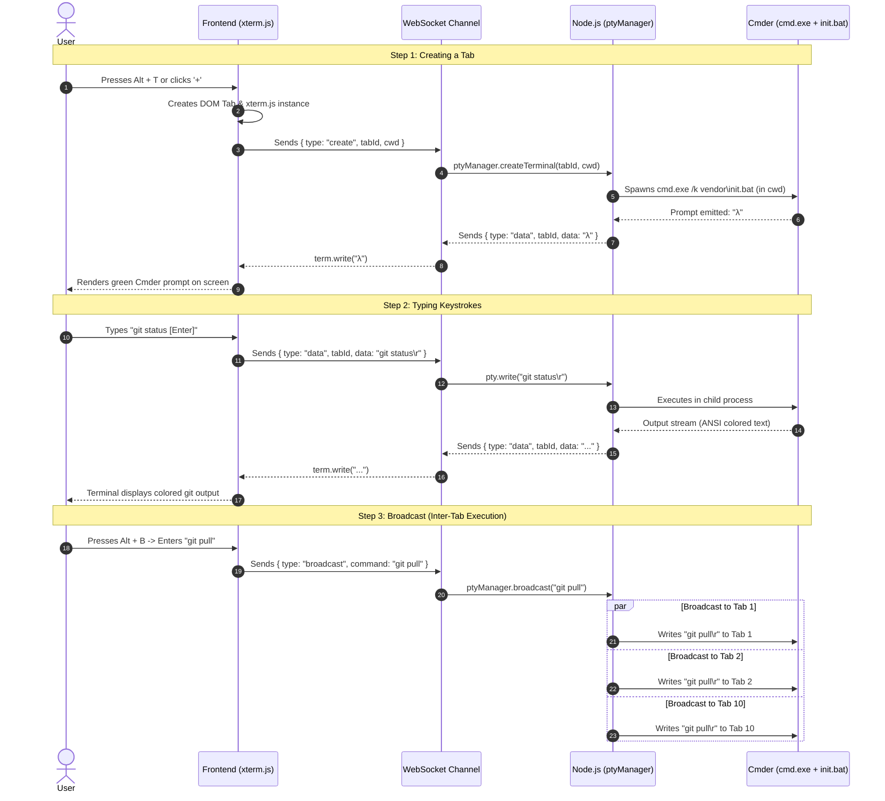

# 🏛️ Cmder Multi-Tab Container — System Architecture & Engineering Guide

This document explains the technical architecture, design decisions, data flow, and thought process behind building this application. It is written as a reference guide for software engineers.

---

## 1. High-Level Architecture Diagram

---

## 2. End-to-End Data Flow Sequence

---

## 3. Technology Stack & Design Decisions (Why We Chose Each)

| Technology | What it is | Why we chose it (Engineering Rationale) |
| :--- | :--- | :--- |
| **Node.js** | Backend runtime | Lightweight, event-driven, handles thousands of concurrent I/O streams with low memory footprint. |
| **`node-pty`** | Pseudoterminal fork for Node | Native terminals in Windows require a real pseudo-console (`ConPTY` or `winpty`). Standard `child_process.spawn` cannot handle interactive programs like `vi`, `top`, or escape sequences. `node-pty` provides true PTY emulation. |
| **`xterm.js`** | Terminal UI engine | Industry standard (powers VS Code). Renders ANSI escape codes, colors, cursor movements, and UTF-8 characters at 60 FPS using canvas/DOM. |
| **Vanilla ES6 Modules** | Frontend structure | **Zero build steps.** No Webpack, Vite, or Babel required. Browsers natively import ES modules (`import`/`export`). Clean, instantaneous startup with zero bundle overhead. |
| **Vanilla CSS Grid** | Layout engine | Allows switching between single-window tab view and 2x2, 2x3, or 3x3 split screens with a single CSS class change. |
| **WebSockets (`ws`)** | Real-time transport | Terminal input/output is a continuous bidirectional character stream. WebSockets offer sub-millisecond latency without HTTP polling overhead. |
| **Stand-alone App Mode (`--app=`)** | Window launcher | Instead of packaging a 200MB Electron binary that takes minutes to compile, Windows Edge/Chrome has a built-in `--app=URL` mode. It launches a borderless, native desktop window with no browser address bar and instant startup. |

---

## 4. Software Engineering Insights: How We Solved Core Problems

### Problem 1: The Overengineering Trap
* **The temptation:** Use Electron + React + Redux + TypeScript + Webpack + Tailwind.
* **The problem with that:** 500MB `node_modules`, native build tools required (Python, MSVC C++ compiler which wasn't on the machine), slow build pipelines.
* **Our solution:** Clean **Vanilla ES6 modular architecture** with Node.js and standard CSS. Fast, zero compiler dependencies, instant to run.

### Problem 2: Browser Shortcut Collisions (`Ctrl+T` vs `Alt+T`)
* **The challenge:** Browsers like Chrome hard-code `Ctrl+T` to open a browser tab and `Ctrl+W` to close the browser. JavaScript `event.preventDefault()` cannot override them in standard tabs.
* **The architectural solution:** We implemented a unified **`Alt + Key` shortcut matrix** (`Alt+T`, `Alt+W`, `Alt+Arrows`, `Alt+1..9`). Browsers never intercept `Alt` keys for tabs, giving 100% reliable shortcut behavior anywhere.

### Problem 3: Multi-Project Path Preservation (Zero-Loss Caching)
* **The challenge:** Terminal processes die when closed; developers lose track of their working directories across 10 different repos.
* **The architectural solution:** A two-tier persistence layer:
  1. **In-Memory State (`state.js`):** Tracks each tab's active directory (`cwd`) and title.
  2. **Debounced Persistence (`session.js`):** Real-time auto-saves to both browser `localStorage` and `last_session.json` on disk. When reopening the container, it reads the file and spawns the exact tabs right back into their folders.

### Problem 4: True Process Isolation
* **The challenge:** If one tab runs a long command (e.g. `npm install`), other tabs must not lag or freeze.
* **The architectural solution:** Each tab has an independent operating system process spawned by `node-pty`. Node's asynchronous event loop streams each PTY's stdout independently over WebSockets.

---

## 5. Real-World Use Cases

1. **Microservices / Full-Stack Development:**
   * Tab 1: Frontend (`/client` - `npm run dev`)
   * Tab 2: Backend API (`/server` - `go run main.go`)
   * Tab 3: Docker Containers (`docker compose up`)
   * Tab 4: Database Shell (`redis-cli` or `psql`)
   * *Switch between all of them in 1 millisecond using `Alt+1..4`.*

2. **Multi-Repository Git Operations (Broadcast Mode):**
   * Working across 5 microservices that all need updating.
   * Press `Alt + B` -> type `git pull origin main` -> Enter.
   * All 5 tabs pull and update at the same time.

3. **Comparison & Debugging (Grid Mode):**
   * Press `Alt + G` to split into a 2x2 grid.
   * Watch client logs on the left and server logs on the right side-by-side.
