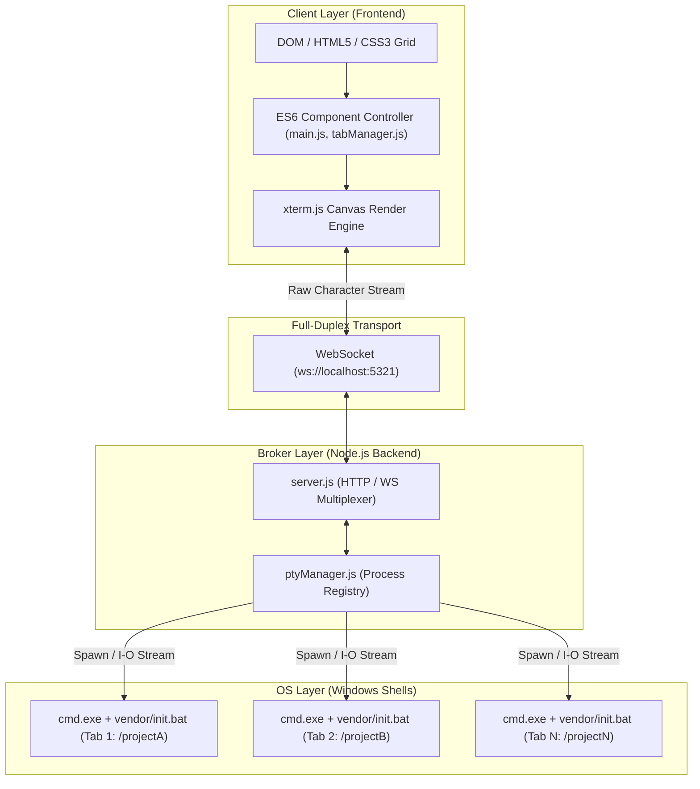

# 🏛️ 01. Architecture Overview

## 1. Architectural Pattern: The PTY Broker Pattern

The Cmder Multi-Tab Container is designed around the **PTY Broker Pattern**:



### Why this pattern?
Terminals are fundamentally different from web pages:
1. **Stateful Streams:** Unlike REST APIs (request -> response), terminals are **continuous, asynchronous byte streams** (stdin -> stdout/stderr).
2. **Interactive VT100 / ANSI Escape Sequences:** Shells emit control sequences to position the cursor, change font colors, clear screens, and handle line wraps.
3. **OS-Level Handles:** A shell process must believe it is attached to a real physical console/teletype (PTY).

The **Broker Layer** acts as the bridge:
- It launches real OS processes via `node-pty`.
- It maps each process to a unique `tabId`.
- It multiplexes all active terminal streams over a single WebSocket connection.

---

## 2. Directory & Module Responsibilities

```
extension_cmder/
├── server/                       # BACKEND MODULES
│   ├── cmderDetector.js          # Discovers Cmder installation & init.bat
│   ├── ptyManager.js             # Spawns, resizes, and writes to node-pty shells
│   └── routes.js                 # Serves HTTP static files & REST API endpoints
│
├── public/                       # FRONTEND MODULES (ES6)
│   ├── js/
│   │   ├── theme.js              # Color palette definitions for xterm.js
│   │   ├── state.js              # Centralized in-memory reactive state
│   │   ├── terminal.js           # xterm instance creation & event binding
│   │   ├── tabManager.js         # Tab lifecycle (create, switch, close, rename)
│   │   ├── shortcuts.js          # Unified keyboard shortcut dispatcher
│   │   ├── broadcast.js          # Multi-tab broadcast controller
│   │   ├── grid.js               # CSS Grid layout manager (1x1, 2x2, 3x3)
│   │   ├── session.js            # Persistence engine (localStorage + disk JSON)
│   │   ├── helpModal.js          # Guide & cheat sheet modal controller
│   │   └── main.js               # Application coordinator / entry point
│   ├── index.html                # App layout & semantic markup
│   └── style.css                 # Dark theme, layout & modal styles
```

---

## 3. High-Level Data Flow

1. **User Action (e.g. presses `Alt + T`):**
   * `shortcuts.js` traps the event and calls `createTab()` in `tabManager.js`.
2. **Tab Creation:**
   * `tabManager.js` creates a DOM container `#pane_tab_123` and calls `createTerminalInstance()` in `terminal.js`.
   * A WebSocket payload `{ type: "create", tabId: "tab_123", cwd: "E:\\Project" }` is sent to `server.js`.
3. **Process Spawn:**
   * `ptyManager.js` spawns `cmd.exe /k "E:\Programs\cmder\vendor\init.bat"` with `cwd: "E:\\Project"`.
4. **Output Streaming:**
   * When the shell prints `λ`, `ptyManager.js` emits data over WebSocket: `{ type: "data", tabId: "tab_123", data: "λ" }`.
   * `main.js` receives the frame and calls `term.write("λ")`.
   * `xterm.js` renders the colored character onto the canvas at 60 FPS.
