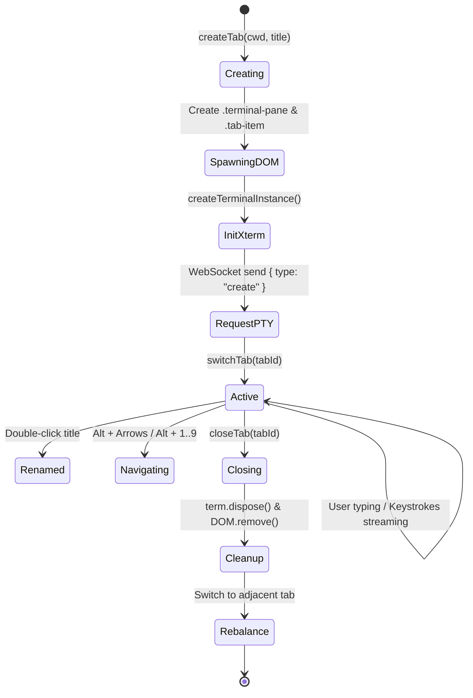

# 💻 03. Frontend Engineering

## 1. Why Vanilla ES6 Modules (Zero-Build Philosophy)

Modern web development often introduces heavy build pipelines (Webpack, Vite, Babel, Rollup) for simple desktop apps. 

### What we chose instead:
We wrote the frontend using **native standard ES6 modules**:
```html
<script type="module" src="/js/main.js"></script>
```

### Why this is a superpower:
1. **Zero Compilation:** No `npm run build` or watchers needed. Edit code, save, refresh—changes appear instantly.
2. **Native Browser Optimization:** Modern browser JavaScript engines natively optimize and cache ES modules.
3. **True Modularity:** Every module has explicit inputs (`import`) and outputs (`export`).

---

## 2. Centralized Reactive State (`public/js/state.js`)

Instead of scattered global variables or complex Redux stores, we centralize state in a single exported object:

```js
export const state = {
  ws: null,
  tabs: new Map(), // tabId -> TabObject
  activeTabId: null,
  isGridMode: false,
  tabCounter: 0,
  defaultCwd: ''
};
```

### The `TabObject` Model:
```ts
interface TabObject {
  id: string;          // Unique ID: 'tab_1729100000_1'
  title: string;       // Display name: 'Frontend'
  cwd: string;         // Working directory: 'E:\Projects\app'
  customName: boolean; // Flag indicating if user manually renamed it
  term: Terminal;      // xterm.js instance
  fitAddon: FitAddon;  // Auto-resize calculator
  element: HTMLElement;// DOM container (.terminal-pane)
  tabEl: HTMLElement;  // DOM header button (.tab-item)
}
```

---

## 3. The Tab Lifecycle (`public/js/tabManager.js`)



### Key Lifecycle Principles:
1. **Never Destroy on Inactive:** When a tab is not active, its DOM container is hidden with `display: none` (or rearranged in grid mode), but **its terminal process and canvas stay fully alive in memory**. Output continues streaming in the background.
2. **Auto-Refit on Switch:** Whenever a tab becomes active, `tab.fitAddon.fit()` is called with a 50ms delay to recalculate column and row dimensions for the current container size.
3. **Session Auto-Save:** Every tab creation, renaming, switching, or closing triggers a debounced call to `autoSaveSession()`.

---

## 4. Multi-Layout Dynamic CSS Grid Engine (`public/js/grid.js`)

When you toggle Grid Mode (<kbd>Alt + G</kbd>), the viewport changes from absolute single-tab overlay to CSS Grid:

```css
.terminal-viewport.grid-mode {
  display: grid;
  gap: 4px;
}
```

The layout automatically adapts based on tab count:
* **1 Tab:** `1fr` (Full screen)
* **2 Tabs:** `1fr 1fr` (Horizontal split)
* **3-4 Tabs:** `1fr 1fr` x `1fr 1fr` (2x2 Grid)
* **5-6 Tabs:** `1fr 1fr 1fr` x `1fr 1fr` (3x2 Grid)
* **7+ Tabs:** `1fr 1fr 1fr` with auto-fit rows.

Once the layout shifts, `applyGridLayout()` calls `fitAddon.fit()` on **every visible tab simultaneously**, and sends updated `{ cols, rows }` to the backend so every shell window wraps text cleanly.
