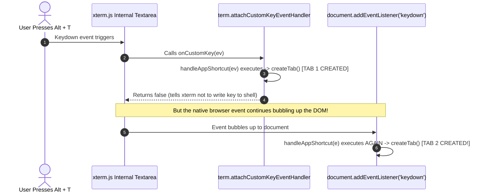

# ⌨️ 04. Event Bubbling, Keyboard Interception & Debouncing

This chapter covers one of the most critical challenges in web-based desktop engineering: **event propagation collisions, keyboard repeats, and browser shortcuts**.

---

## 1. The Bug: Duplicate Tab Creation & Tab Skipping

### What happened:
* Pressing <kbd>Ctrl + T</kbd> or <kbd>Alt + T</kbd> spawned **2 or 3 tabs at once**.
* Pressing <kbd>Ctrl + →</kbd> or <kbd>Alt + →</kbd> moved **2 tabs forward instead of 1** (skipping tabs).

### Why did this happen? (The DOM Bubbling Trap)



Because `term.attachCustomKeyEventHandler` only controls whether `xterm.js` writes the key to the shell buffer, the native DOM `keydown` event still bubbled up to `document`. Both listeners caught the same keypress, resulting in **double execution**.

Additionally, if a user held the key for more than 50ms, Windows' OS keyboard repeat sent multiple `keydown` events (`e.repeat = true`), causing duplicate tabs.

---

## 2. The Solution: Triple-Layer Defense

In [**`public/js/shortcuts.js`**](file:///e:/2026/MyBigProjects_SimpleLib/extension_cmder/public/js/shortcuts.js), we implemented a triple-layer guard:

```js
// Throttle timestamps
let lastCreateTime = 0;
let lastNavTime = 0;

export function handleAppShortcut(e, { createTab, navigateTab, ... }) {
  // Layer 1: Event De-duplication Flag
  if (e._handledByApp) {
    if (e.preventDefault) e.preventDefault();
    if (e.stopPropagation) e.stopPropagation();
    return false;
  }

  const markHandled = () => {
    e._handledByApp = true;
    if (e.preventDefault) e.preventDefault();
    if (e.stopPropagation) e.stopPropagation();
    if (e.stopImmediatePropagation) e.stopImmediatePropagation();
  };

  // Layer 2: Ignore OS Key Repeats
  if ((e.altKey && e.key.toLowerCase() === 't') || ...) {
    if (e.repeat) return false;

    // Layer 3: Time-Based Throttle (Cooldown)
    const now = Date.now();
    if (now - lastCreateTime < 250) {
      markHandled();
      return false;
    }
    lastCreateTime = now;

    markHandled();
    createTab();
    return false;
  }
}
```

### Why this works:
1. **`_handledByApp`:** The moment the first listener processes the key, it stamps `e._handledByApp = true` and stops propagation. When the event hits the second listener, it is instantly ignored.
2. **`e.repeat = false`:** Holding down the key will not create infinite tabs.
3. **Time-Based Cooldown:** Enforces a 150–250ms window between consecutive tab actions, ensuring navigation moves strictly **one tab at a time**.

---

## 3. The Browser Collision Problem: Why `Alt + Key`?

### The Problem with `Ctrl + T` and `Ctrl + W`:
Browsers (Chrome, Edge, Brave, Firefox) reserve <kbd>Ctrl + T</kbd> and <kbd>Ctrl + W</kbd> at the browser window level for browser tabs. JavaScript in standard web pages cannot `preventDefault()` these shortcuts.

### The Solution:
We mapped all primary operations to **`Alt + Key`**:
* <kbd>Alt + T</kbd> — New Tab
* <kbd>Alt + W</kbd> — Close Tab
* <kbd>Alt + ←</kbd> / <kbd>→</kbd> — Navigate Tabs
* <kbd>Alt + 1..9</kbd> — Direct Jump
* <kbd>Alt + B</kbd> — Broadcast Bar
* <kbd>Alt + G</kbd> — Grid View
* <kbd>Alt + H</kbd> — Guide Modal

Browsers **never** intercept `Alt + Key` combinations for tab management, ensuring 100% reliable operation across every environment.

---

## 4. Smart Clipboard Engineering

### 1. Auto-Copy on Select:
```js
term.onSelectionChange(() => {
  if (term.hasSelection()) {
    const selected = term.getSelection();
    if (selected && selected.trim().length > 0) {
      navigator.clipboard.writeText(selected);
      showCopyToast('✓ Copied selected text!');
    }
  }
});
```

### 2. Context-Aware <kbd>Ctrl + C</kbd>:
* **If text is highlighted:** Copies the selected text to the clipboard and clears the selection (does not send interrupt signal `\x03` to the running program).
* **If nothing is highlighted:** Allows <kbd>Ctrl + C</kbd> through to send `\x03` (SIGINT) to terminate running shell commands.

### 3. Smart Right-Click:
* Right-click with active selection: Copies selection.
* Right-click without selection: Pastes clipboard text directly into the shell.
