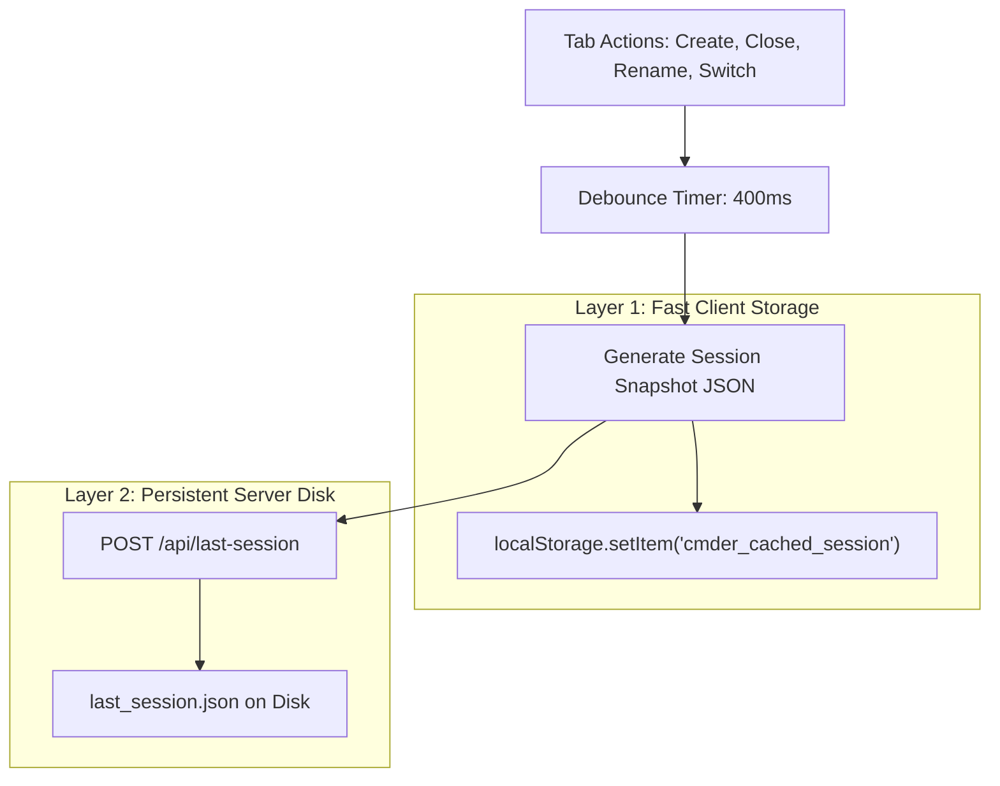
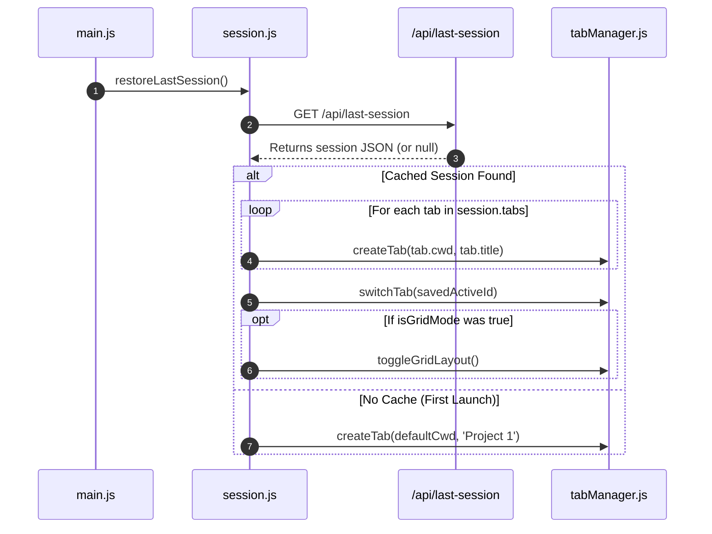

# 💾 05. Persistence & State Recovery

Terminal developers work across multiple repositories simultaneously. When closing the application, losing active project paths and tabs wastes significant setup time.

This document explains the architecture of the **continuous zero-loss caching engine** in `public/js/session.js`.

---

## 1. Dual-Layer Persistence Strategy

To ensure reliability across browser refreshes, machine reboots, and multi-profile setups, the app writes state to **two separate layers**:



### Why Dual-Layer?
1. **`localStorage`:** Instantaneous, zero network overhead, synchronous read on reload.
2. **`last_session.json` (Server Disk):** Survives browser cache wipes, operates across different browsers, and is accessible even if the app runs in incognito or standalone desktop mode.

---

## 2. Session Snapshot Schema

The snapshot written to `last_session.json` follows this strict JSON schema:

```json
{
  "tabs": [
    {
      "title": "Frontend",
      "cwd": "E:\\Projects\\ecom\\client",
      "customName": true
    },
    {
      "title": "Backend API",
      "cwd": "E:\\Projects\\ecom\\server",
      "customName": true
    },
    {
      "title": "Docker",
      "cwd": "E:\\Projects\\ecom",
      "customName": false
    }
  ],
  "activeIndex": 1,
  "isGridMode": false
}
```

### Key Schema Design Decisions:
* **`cwd`:** Stores the absolute folder path so the new PTY shell can spawn directly in the user's project directory.
* **`customName`:** A boolean flag. If `true`, the custom title chosen by the user is preserved; if `false`, the tab dynamically displays the folder basename.
* **`activeIndex`:** Remembers which tab was in focus when the window closed.
* **`isGridMode`:** Remembers whether the user was viewing a single tab or a multi-tab grid split view.

---

## 3. Debouncing: Why and How

### The Problem without Debouncing:
If a user rapidly renames a tab, clicks between tabs, or opens 4 tabs in a row, firing HTTP POST requests on every micro-event causes I/O bottlenecks and disk thrashing.

### The Solution:
`autoSaveSession()` uses a **400ms trailing debounce**:

```js
let saveTimeout = null;

export function autoSaveSession() {
  clearTimeout(saveTimeout);
  saveTimeout = setTimeout(async () => {
    // 1. Compile state snapshot
    const sessionData = compileState();

    // 2. Write to localStorage
    localStorage.setItem('cmder_cached_session', JSON.stringify(sessionData));

    // 3. Write to server disk
    await fetch('/api/last-session', {
      method: 'POST',
      headers: { 'Content-Type': 'application/json' },
      body: JSON.stringify(sessionData)
    });
  }, 400);
}
```

Additionally, `window.addEventListener('beforeunload', autoSaveSession)` guarantees a flush when the user closes the window.

---

## 4. Cold-Start Hydration Flow

When the app launches (`main.js` -> `fetchAppInfo()`):



This guarantees that restarting the computer or reopening the app restores the entire developer workspace in less than 500 milliseconds.
