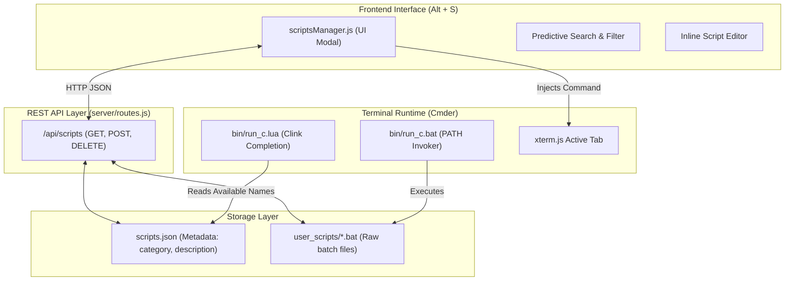

# 📜 06. Scripts & Batch Store Engineering Specification

**Document Version:** 1.0.0  
**Module Reference:** `server/routes.js`, `public/js/scriptsManager.js`, `bin/run_c.bat`, `bin/run_c.lua`, `user_scripts/`  
**Target:** Senior Engineers & Product Owners  

---

## 1. Feature Overview & Problem Solved

Terminal power users frequently execute multi-step routines:
* Logging into remote servers with specific SSH configurations and proxy jumps.
* Starting multi-container microservice stacks.
* Running database migrations and cache flushes.
* Setting complex environment variables for local testing.

Prior to this feature, developers had to create arbitrary `.bat` scripts on their Desktop or search through bash history. 

The **Scripts & Batch Store** provides:
1. **Centralized Storage:** Dual persistence in `scripts.json` and standalone executable files in `user_scripts/*.bat`.
2. **Global PATH Execution:** `run_c <script_name>` executable from any terminal tab, in any directory.
3. **Predictive Search & 1-Click Launch:** UI modal (`Alt + S`) with instant filtering and Enter-to-execute.
4. **Shell Auto-Completion:** Native Clink Lua integration enabling `Tab` completion in Cmder shells.

---

## 2. Component Architecture & Data Flow



---

## 3. Data Schema & File Structure

### 3.1 Metadata Record (`scripts.json`)
```json
[
  {
    "id": "server_ssh",
    "name": "server_ssh",
    "description": "Connect to staging server with keep-alive",
    "category": "Servers",
    "content": "@echo off\necho Connecting to Staging...\nssh -o ServerAliveInterval=60 user@staging.internal",
    "updatedAt": "2026-10-22T14:30:00.000Z"
  }
]
```

### 3.2 Dual-Synchronization Model
* When a script is saved via the UI or REST API:
  1. The executable batch file is written to `user_scripts/<name>.bat`.
  2. The descriptive metadata is written to `scripts.json`.
* When `/api/scripts` is queried with `GET`:
  * The backend scans `user_scripts/` for any `.bat` or `.cmd` files that may have been manually placed on disk by the user and auto-indexes them into `scripts.json`.

---

## 4. REST API Specification

### 4.1 `GET /api/scripts`
* **Purpose:** Retrieves all indexed scripts.
* **Response:** Array of script objects (`200 OK`).

### 4.2 `POST /api/scripts`
* **Purpose:** Creates or updates a batch script.
* **Payload:**
  ```json
  {
    "name": "start_services",
    "category": "DevOps",
    "description": "Start Docker and Redis",
    "content": "@echo off\ndocker compose up -d\n"
  }
  ```
* **Validation:** Sanitizes script names to alphanumeric and underscore characters `[a-zA-Z0-9_\-]` to prevent directory traversal attacks.

### 4.3 `DELETE /api/scripts?name=<name>`
* **Purpose:** Deletes the script from `scripts.json` and unlinks `user_scripts/<name>.bat`.

---

## 5. Terminal CLI Engine (`bin/run_c.bat`)

The application automatically injects its `bin/` directory into the environment PATH of spawned shells in `server/ptyManager.js`:

```js
const binDir = path.join(this.rootDir, 'bin');
const scriptsDir = path.join(this.rootDir, 'user_scripts');
processEnv.PATH = `${binDir};${scriptsDir};${processEnv.PATH}`;
```

### Execution Behavior:
* Running `run_c` with no arguments prints an ASCII header and lists all available scripts by category.
* Running `run_c <script_name> [args...]` locates `user_scripts/<script_name>.bat` and executes it, forwarding all trailing parameters `%*`.

---

## 6. Cmder Clink Auto-Completion (`bin/run_c.lua`)

To give developers native shell autocompletion when typing in Cmder:

```lua
local function get_scripts()
    local scripts = {}
    -- Queries scripts.json or lists user_scripts/*.bat
    -- Returns array of script names
end

local run_c_parser = clink.arg.new_parser()
run_c_parser:set_arguments({ get_scripts })
clink.arg.register_parser("run_c", run_c_parser)
```

Typing `run_c ser` followed by `Tab` automatically completes to `run_c server_ssh`.

---

## 7. Frontend User Experience (`public/js/scriptsManager.js`)

1. **Activation:** Pressing `Alt + S` or clicking **📜 Scripts** in the header.
2. **Predictive Auto-Match:**
   * Typing in the search input filters results in real-time.
   * Pressing `Enter` automatically executes the first (highest-ranked) match in the active tab.
3. **Execution Options:**
   * **Run in Active Tab:** Injects `run_c <name>\r` directly into the current terminal session.
   * **Run in New Tab:** Spawns a new tab in the current working directory and triggers the script automatically.
