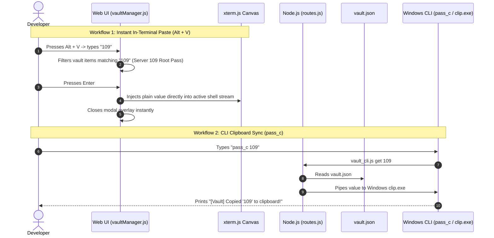

# 🔐 07. Secrets & Notes Vault Engineering Specification

**Document Version:** 1.0.0  
**Module Reference:** `server/routes.js`, `public/js/vaultManager.js`, `bin/pass_c.bat`, `bin/val_c.bat`, `bin/vault_cli.js`, `vault.json`  
**Target:** Senior Engineers & Product Owners  

---

## 1. Feature Overview & Problem Solved

Developers routinely work with sensitive, high-friction data:
* Root passwords for remote servers and virtual machines.
* Database connection strings and tokens.
* Cloud API keys and personal access tokens.
* Frequent terminal notes or complex one-liner commands.

Traditional password managers require switching windows, searching, copying, returning to the console, and pasting. This introduces distraction and breaks terminal flow.

The **Secrets & Notes Vault** provides an abbreviation-driven, in-terminal credential lookup engine that allows developers to:
1. **Paste directly into the active shell with zero window switching (`Alt + V` -> type abbreviation -> Enter).**
2. **Copy passwords to the Windows clipboard directly from the CLI (`pass_c <key>`).**
3. **Keep sensitive values masked visually on screen.**
4. **Auto-complete abbreviations using Clink Lua.**

---

## 2. Component Architecture & Workflows



---

## 3. Data Schema (`vault.json`)

```json
[
  {
    "id": "server_109",
    "key": "109",
    "title": "Root password for staging server 109",
    "type": "Password",
    "value": "sUp3r$3cr3tP@ssw0rd!",
    "isSecret": true,
    "updatedAt": "2026-10-22T14:45:00.000Z"
  },
  {
    "id": "docker_clean",
    "key": "dclean",
    "title": "Prune all stopped containers & unused images",
    "type": "Snippet",
    "value": "docker system prune -af --volumes",
    "isSecret": false,
    "updatedAt": "2026-10-22T14:48:00.000Z"
  }
]
```

### Supported Item Types:
1. **Password:** Masked by default (`••••••••`), designed for system logins and SSH passwords.
2. **Token:** API tokens and secret keys with 1-click clipboard copy.
3. **Note:** Multi-line configuration snippets, IP address lists, or reminders.
4. **Snippet:** Complex shell commands ready for 1-click paste into the terminal.

---

## 4. REST API Specification

### 4.1 `GET /api/vault`
* **Purpose:** Returns the complete list of vault items.
* **Response:** Array of vault records (`200 OK`).

### 4.2 `POST /api/vault`
* **Purpose:** Creates or updates a vault item.
* **Payload:**
  ```json
  {
    "key": "prod_db",
    "title": "Production Read Replica Token",
    "type": "Token",
    "value": "eyJhbGciOiJIUzI1NiIs...",
    "isSecret": true
  }
  ```
* **Validation:** Sanitizes keys to `[a-zA-Z0-9_\-]` and timestamps the update.

### 4.3 `DELETE /api/vault?id=<id>`
* **Purpose:** Removes an entry from `vault.json`.

---

## 5. CLI Invocation Engine (`bin/pass_c.bat` & `bin/val_c.bat`)

Both `pass_c` and `val_c` point to `bin/vault_cli.js`.

### 5.1 Commands
* **`pass_c` or `val_c`:** Lists all stored credentials in an ASCII table displaying Type, Key, and Description (values remain hidden).
* **`pass_c <key>`:** Searches for `<key>` (case-insensitive). Upon match, it silently spawns Windows `clip.exe` and pipes the value to the system clipboard:
  ```js
  const clip = spawnSync('clip.exe', { input: found.value, encoding: 'utf-8' });
  ```
* **`pass_c show <key>`:** Explicitly outputs the raw unmasked value to stdout.

---

## 6. Frontend Quick-Palette (`public/js/vaultManager.js`)

1. **Shortcuts:** `Alt + V` or `Alt + P` or header button **🔐 Vault**.
2. **Zero-Click Insertion:**
   * When the user opens the palette, the search input receives immediate focus.
   * Typing an abbreviation immediately highlights the best match.
   * Pressing `Enter` writes the value directly into `state.activeTabId`'s terminal via `term.write(item.value)` or WebSocket data frame, then closes the palette.
3. **Security Masking:**
   * Sensitive items display masked dots (`••••••`).
   * Clicking the eye icon (👁) unmasks the value for 10 seconds before auto-masking.
   * 1-Click Copy button copies to navigator clipboard with visual toast feedback.
