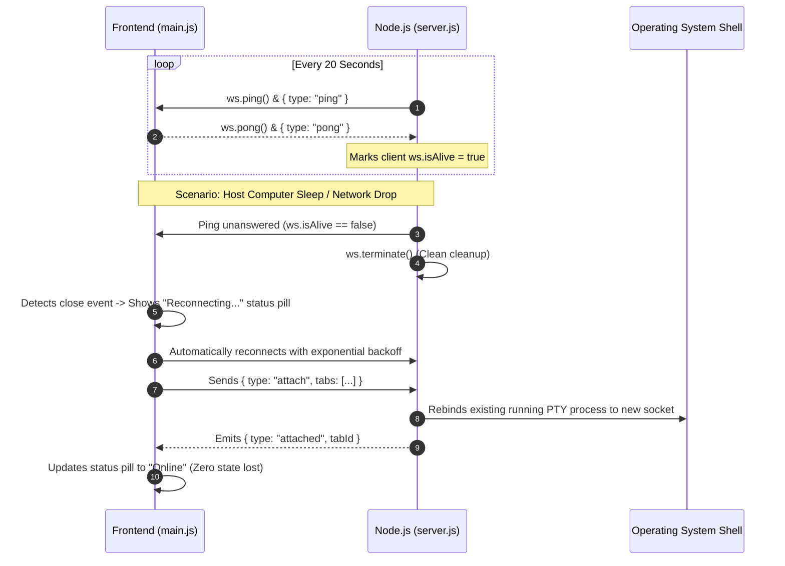

# 🛡️ 09. Reliability, Heartbeat & Desktop App Integration

**Document Version:** 1.0.0  
**Module Reference:** `server.js`, `server/ptyManager.js`, `public/js/main.js`, `custome_cmder.bat`, `create_shortcut.bat`  
**Target:** Senior Engineers & Product Owners  

---

## 1. Reliability & Resilience Engineering

### 1.1 The Idle Connection Freeze Problem
In early iterations, developers reported that after leaving terminal tabs open for several hours or waking a laptop from sleep, the terminal appeared completely frozen. Keystrokes were ignored, forcing the user to kill and reopen their tabs.

### Root Causes Identified:
1. **TCP Connection Silently Dropped:** Middleboxes, routers, and operating system power-saving modes silently drop idle TCP sockets without emitting a `close` or `RST` packet.
2. **Orphaned PTY Handles:** When the frontend refreshed or reconnected, the backend created new terminal processes rather than reconnecting to the existing running shells, leading to process leaks.

---

## 2. Bidirectional Heartbeat & Keep-Alive Protocol

To maintain continuous connectivity, `server.js` and `public/js/main.js` implement an automated 20-second ping/pong heartbeat:



### 2.1 The `attach` Protocol Specification
When reconnecting, the client emits:
```json
{
  "type": "attach",
  "tabs": [
    { "tabId": "tab_1729000000_1", "cwd": "E:\\Projects\\backend", "cols": 120, "rows": 30 },
    { "tabId": "tab_1729000000_2", "cwd": "E:\\Projects\\frontend", "cols": 120, "rows": 30 }
  ]
}
```

* If the backend's `PtyManager` still has the process active in its registry, it simply rebinds the data listener to the new socket.
* If the process was terminated by the OS, it transparently spawns a fresh shell in the exact same `cwd` and returns `{ type: "created", tabId }`.

---

## 3. Clipboard Anti-Duplication Engineering

### 3.1 The Double-Copy / Double-Paste Bug
In browser-based terminals, both `document.addEventListener('copy')` and `xterm.js`'s internal textarea capture clipboard events. Without strict event fencing, pressing `Ctrl + C` or selecting text resulted in duplicate copied strings or doubled paste inputs.

### 3.2 Implemented Fix
1. **Debounced Selection Capture:** The `selectionchange` event is throttled to prevent flooding the clipboard buffer on every pixel drag.
2. **Explicit Event Cancellation:** Clipboard events in `public/js/shortcuts.js` and `terminal.js` apply `e.preventDefault()` and `e.stopPropagation()` with a custom `_handledByApp` flag, preventing browser textarea duplication while maintaining native OS clipboard fidelity.

---

## 4. Native Windows Desktop App Integration

While the container is accessible from any web browser at `http://localhost:5321`, developers prefer a dedicated, borderless desktop window that feels like a native desktop app.

### 4.1 Standalone App Mode (`custome_cmder.bat`)
The launcher script detects installed Chromium-based browsers (Microsoft Edge or Google Chrome) and launches the application in `--app` mode:

```bat
:: Checks for Edge or Chrome
start "" "%BROWSER_CMD%" --app=http://localhost:5321 --window-size=1280,820
```

#### Advantages of App Mode:
* **No Browser Chrome:** Strips URL address bar, browser tabs, bookmarks, and extension bars.
* **Dedicated Taskbar Icon:** Displays in the Windows Taskbar as an independent application.
* **Shortcut Safety:** Eliminates browser hotkey hijacking.

### 4.2 Windows Desktop Shortcut Generator (`create_shortcut.bat`)
Generates a persistent Windows `.lnk` shortcut pointing to `custome_cmder.bat` with the official Cmder icon (`assets\cmder.ico`) using Windows Script Host (WSH) COM object:

```powershell
$ws = New-Object -ComObject WScript.Shell
$s = $ws.CreateShortcut('%~dp0Cmder Container.lnk')
$s.TargetPath = '%~dp0custome_cmder.bat'
$s.IconLocation = '%~dp0assets\cmder.ico,0'
$s.Save()
```
It automatically places a copy on the user's Windows Desktop for 1-click access.
