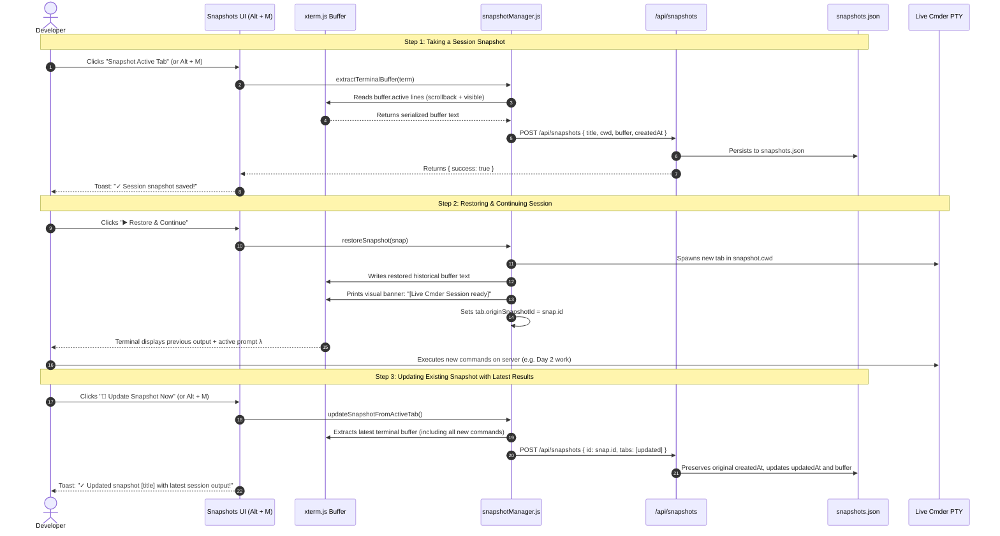

# 📸 10. Session Snapshots, Buffer Serialization & Re-execution

**Document Version:** 1.0.0  
**Module Reference:** `public/js/snapshotManager.js`, `server/routes.js`, `server.js`, `snapshots.json`  
**Target:** Senior Engineers, Architects & Product Owners  

---

## 1. Feature Overview & Problem Solved

Terminal developers routinely run commands that produce extensive, valuable output:
* Test suites (`npm test`, `pytest`, `go test`) with assertion traces.
* Build logs and Docker container startup output.
* Cloud deployments, database migrations, and terraform plans.
* Multi-command debugging runs across remote servers.

### The Problem:
* When a developer closes their terminal or shuts down their computer, the entire historical command log and output buffer are lost.
* If a bug occurs, copying multi-page console output manually is tedious and error-prone.
* Developers want to be able to "freeze" a terminal state with all its output and later **resume/continue working from that exact state**, or quickly clear/reset their shell without killing and reopening tabs.

### The Solution:
The **Session Snapshots & Buffer Memory Engine** allows developers to:
1. **Capture Full Session Snapshots:** Serialize the complete terminal buffer, scrollback, command history, and results for the active tab or all open tabs in one click.
2. **Restore & Continue Execution:** Reopen a snapshot at any time in a new tab. The terminal restores the complete historical output log and connects to a live Cmder shell in that working directory, allowing the developer to continue executing commands immediately.
3. **Export as Markdown (`.md`):** Generate clean, GitHub-flavored Markdown documents formatted with headers, metadata tables, and fenced `bash` code blocks for external documentation, PRs, issue tickets, and team sharing.
4. **Export as Image (`.png`):** Render high-resolution (2x retina) window cards with macOS/Windows traffic lights, title bar, prompt syntax highlighting, and monospaced console typography directly using pure client-side HTML5 Canvas.
5. **1-Click Log Export:** Copy the entire output log of any session snapshot directly to the Windows clipboard for bug reports, audit trails, or pull requests.
6. **Quick Session Clear & Reset:**
   * **Clear Screen (`Alt + K`):** Clears the terminal screen and scrollback buffer (`term.clear()`) while keeping the shell process alive.
   * **Reset Shell Session:** Kills and respawns a clean, fresh Cmder shell process in the same working directory without closing the tab.

---

## 2. Architecture & Data Flow



---

## 3. Data Schema (`snapshots.json`)

```json
[
  {
    "id": "snap_1729689400123",
    "title": "API Microservice Build & Test Run",
    "description": "Ran npm test and docker compose up before release v2.4",
    "createdAt": "2026-10-23T15:00:00.000Z",
    "updatedAt": "2026-10-24T09:30:00.000Z",
    "tabs": [
      {
        "tabTitle": "API Gateway",
        "cwd": "E:\\Projects\\api-gateway",
        "buffer": "λ npm test\n...\n[Day 2 commands & outputs appended]\nλ ",
        "customName": true
      }
    ]
  }
]
```

### Iterative Snapshot Life Cycle:
1. **Creation:** When first saved, `createdAt` and `updatedAt` are identical.
2. **Restoration:** Restoring sets `tab.originSnapshotId = snap.id` on the tab object.
3. **Continuation:** The developer runs new commands, SSH operations, or server routines.
4. **Iterative Update:** The user clicks **"🔄 Update Snapshot Now"** or **"🔄 Update from Tab"** on the card. The existing snapshot is overwritten with the latest complete buffer without creating redundant duplicate snapshots, and `updatedAt` is refreshed!

---

## 4. REST API Specification

### 4.1 `GET /api/snapshots`
* **Purpose:** Retrieves all saved session snapshots ordered newest first.
* **Response:** Array of snapshot objects (`200 OK`).

### 4.2 `POST /api/snapshots`
* **Purpose:** Saves a new snapshot or updates an existing record.
* **Update Behavior:** If `id` matches an existing snapshot, preserves original `createdAt`, updates `updatedAt` to the current timestamp, and overwrites the terminal buffer.
* **Payload:**
  ```json
  {
    "id": "snap_1729689400123",
    "title": "Database Migration Logs",
    "description": "Output of alembic upgrade head",
    "tabs": [
      { "tabTitle": "DB", "cwd": "E:\\Projects\\db", "buffer": "..." }
    ]
  }
  ```

### 4.3 `DELETE /api/snapshots?id=<id>`
* **Purpose:** Removes a saved snapshot by ID.

---

## 5. Keyboard Shortcuts & User Controls

| Shortcut / Trigger | Action | Description |
| :--- | :--- | :--- |
| **`Alt + M`** | **Snapshots Modal** | Opens the Session Snapshots & Buffer Memory palette. |
| **`Alt + K`** | **Clear Terminal** | Clears the terminal screen and scrollback buffer (`cls`). |
| **Header `📸 Snapshots`** | **Open Modal** | Click trigger in the top navigation bar. |
| **Header `🧹 Clear`** | **Quick Clear** | Clears active terminal display in 1 click. |
| **Modal `🔄 Reset Shell`** | **Reset Process** | Kills and respawns a fresh shell process in the same tab. |
| **Card `▶️ Restore`** | **Resume Work** | Restores historical output in a new tab with live Cmder session. |
| **Card `🔄 Update`** | **Update Snapshot** | Overwrites snapshot with active tab's latest output and new commands. |
| **Card / Modal `📝 MD`** | **Save Markdown** | Downloads formatted GitHub-compatible `.md` file with metadata and code blocks. |
| **Card / Modal `🖼️ PNG`** | **Save Image** | Generates high-res 2x retina window card image using HTML5 Canvas. |
| **Banner `🔄 Update Now`** | **Quick Update** | 1-Click update of the active tab's linked snapshot. |
| **Card `📋 Copy Log`** | **Export Output** | Copies entire session output log to clipboard. |
| **Card `🗑️`** | **Delete Snapshot** | Permanently deletes snapshot from disk. |

