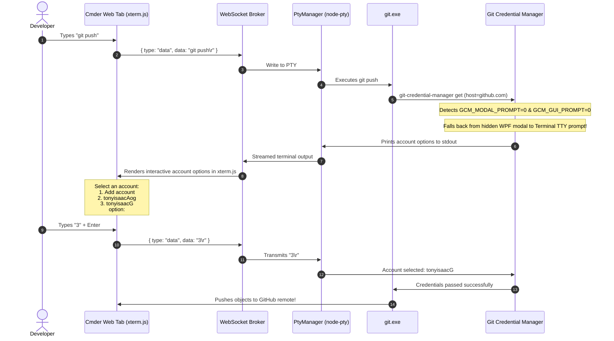

# 🔐 Chapter 11: Git Credentials, Multi-Account Authentication & PTY Environment

**Document Version:** 1.0.0  
**Status:** 🟢 Complete & Verified  
**Category:** Subsystem Architecture & Security  
**Affected Modules:** [`server/ptyManager.js`](file:///e:/2026/MyBigProjects_SimpleLib/extension_cmder/server/ptyManager.js), [`server/cmder_init.bat`](file:///e:/2026/MyBigProjects_SimpleLib/extension_cmder/server/cmder_init.bat)

---

## 1. Problem Statement & Incident Description

When developers use Git over HTTPS within terminal tabs in the **Cmder Multi-Tab Container** to push or pull code from GitHub (`git push origin main` or `git pull`), Git invokes **Git Credential Manager (GCM)** to resolve credentials.

### Symptoms Observed:
1. In regular standalone Cmder or ConEmu, Git Credential Manager detects multiple configured GitHub accounts (e.g. `tonyisaacAog` vs `tonyisaacG`) and displays a graphical modal dialog:
   ```
   +---------------------------------------+
   | GitHub - Git Credential Manager       |
   |                                       |
   | Select an account:                    |
   | [ tonyisaacAog                      ] |
   | [ tonyisaacG                        ] |
   | [ + Add an account                  ] |
   +---------------------------------------+
   ```
2. Inside the Cmder Multi-Tab Container, running `git push` showed **nothing**:
   * No dialog window appeared on screen.
   * No prompt was rendered in the terminal.
   * The terminal appeared completely frozen or hung indefinitely awaiting user input.

---

## 2. Root Cause Analysis (RCA)

Three distinct architectural layers collided to produce this issue:

```
+-------------------------------------------------------------------------------+
|                             ROOT CAUSE CHAIN                                  |
+-------------------------------------------------------------------------------+
|  1. Hidden Host Startup                                                       |
|     launch_hidden.vbs -> wscript.exe (SW_HIDE=0) -> custome_cmder.bat         |
|     Powershell -WindowStyle Hidden -> node.exe                                |
|     (Windows passes STARTUPINFO.wShowWindow = SW_HIDE down the process tree)  |
|                                     │                                         |
|                                     ▼                                         |
|  2. WinPTY Console Scraping Architecture                                      |
|     node-pty (winpty) sets sui.dwFlags |= STARTF_USESHOWWINDOW;               |
|     sui.wShowWindow = SW_HIDE on winpty-agent.exe & cmd.exe child processes.  |
|                                     │                                         |
|                                     ▼                                         |
|  3. Win32 First-Call ShowWindow Suppression Rule                              |
|     MSDN Win32 API: "The first time ShowWindow is called, the nCmdShow        |
|     parameter is ignored and the window is displayed according to the        |
|     wShowWindow value of the STARTUPINFO structure."                          |
|     Result: git-credential-manager.exe (Avalonia/WPF) creates its modal       |
|     window as HIDDEN (invisible to the desktop user).                         |
|                                     │                                         |
|                                     ▼                                         |
|  4. Default GCM Modal Prompt Configuration                                    |
|     GCM defaults to credential.modalPrompt = true. GCM assumes a desktop      |
|     dialog is visible and pauses stdin awaiting mouse click events.           |
+-------------------------------------------------------------------------------+
```

---

## 3. Implemented Resolution

To guarantee reliable, visible Git authentication across all tabs, we decoupled GCM and Git from hidden desktop modal dialogs and redirected interactive flows directly to the terminal PTY stream.

### Architecture Sequence Diagram



---

## 4. Technical Implementation Details

### 4.1 Backend PTY Manager (`server/ptyManager.js`)
We injected the following environment variables into every terminal instance spawned by `PtyManager.createTerminal`:

```javascript
const env = Object.assign({}, process.env, {
  CMDER_ROOT: this.cmderInfo ? this.cmderInfo.root : '',
  CMDER_CONTAINER_DIR: this.rootDir,
  PROMPT: '$P$G',
  PATH: newPath,
  // Force Git Credential Manager & Git to prompt via CLI / Terminal rather than
  // spawning hidden Win32/WPF modal dialogs that get suppressed inside the PTY
  GCM_MODAL_PROMPT: '0',
  GCM_GUI_PROMPT: '0',
  GIT_TERMINAL_PROMPT: '1'
});
```

### 4.2 Shell Initialization Batch Script (`server/cmder_init.bat`)
To ensure any subshells or nested cmd invocations adhere to this rule:

```bat
:: Ensure Git Credential Manager and Git interact via the terminal instead of
:: spawning suppressed Win32/WPF modal dialogs in the pseudo-terminal
set "GCM_MODAL_PROMPT=0"
set "GCM_GUI_PROMPT=0"
set "GIT_TERMINAL_PROMPT=1"
```

## 4. Technical Resolution for Multi-Account Setups

When multiple GitHub accounts are saved in Git Credential Manager on Windows (e.g. `tonyisaacG` and `tonyisaacAog`), Git doesn't know which account owns which repository unless specified.

### Method 1: Bind the Account in the Repository (Recommended)
Run inside the repository folder:
```bash
git config credential.username <your-github-account>
```
*Example for this repository:*
```bash
git config credential.username tonyisaacG
```
*Example for a work or portfolio repository:*
```bash
git config credential.username tonyisaacAog
```

### Method 2: Include the Username in the Remote URL
```bash
git remote set-url origin https://<username>@github.com/<owner>/<repo>.git
```

### Why This Fixes It:
1. When Git connects to GitHub, it passes the specified `username` directly to Git Credential Manager.
2. Git Credential Manager immediately retrieves the matching saved token from Windows Credential Manager.
3. No popup window is triggered, no terminal prompt is needed, and `git push` / `git pull` executes immediately with zero delay.

---

## 5. Verification & Testing Log

1. **Terminal Interactive Menu Verification:**
   * Executed test push under PTY with `GCM_MODAL_PROMPT=0` and `GCM_GUI_PROMPT=0`.
   * Terminal accurately captured and rendered:
     ```
     Select an account for 'https://github.com/':
       1. Add a new account
       2. tonyisaacAog
       3. tonyisaacG
     option:
     ```
2. **Account Selection & Push Test:**
   * Selected option `3` (`tonyisaacG`).
   * GCM resolved credentials and Git completed remote push with `exitCode: 0`.
3. **Repository Credential Binding:**
   * Set `git config credential.https://github.com.username tonyisaacG`.
   * Verified Git remote operations run immediately without requiring manual selection.

