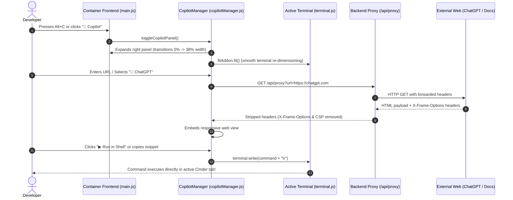

# 🤖 Chapter 12: Embedded AI Copilot & Web Split-Panel Engine

**Document Version:** 1.0.0  
**Status:** 🟡 Architectural Specification & Planning  
**Feature ID:** `[FEAT-12]` / `[FR-13]`  
**Author:** Senior Principal Architect & Product Owner  
**Repository:** `extension_cmder`  
**Target Files:**  
* Frontend: [`public/js/copilotManager.js`](file:///e:/2026/MyBigProjects_SimpleLib/extension_cmder/public/js/copilotManager.js), [`public/index.html`](file:///e:/2026/MyBigProjects_SimpleLib/extension_cmder/public/index.html), [`public/style.css`](file:///e:/2026/MyBigProjects_SimpleLib/extension_cmder/public/style.css), [`public/js/shortcuts.js`](file:///e:/2026/MyBigProjects_SimpleLib/extension_cmder/public/js/shortcuts.js), [`public/js/main.js`](file:///e:/2026/MyBigProjects_SimpleLib/extension_cmder/public/js/main.js)
* Backend: [`server/routes.js`](file:///e:/2026/MyBigProjects_SimpleLib/extension_cmder/server/routes.js), [`server.js`](file:///e:/2026/MyBigProjects_SimpleLib/extension_cmder/server.js)

---

## 1. Problem Statement & Executive Summary

Developers working in terminal-heavy workflows spend a significant portion of their day switching between their command-line environment and external browser windows (e.g. ChatGPT, Claude, StackOverflow, GitHub issues, official API documentation, or localhost development servers).

### Current Pain Points:
1. **Context Switching Penalty (Alt+Tab Friction):** Switching between a full-screen terminal and a web browser disrupts cognitive momentum and leads to window sprawl.
2. **Loss of Visual Continuity:** Developers cannot view command errors, compiler diagnostics, or server logs simultaneously alongside AI explanations or troubleshooting guides without manually tiling two separate Windows desktop applications.
3. **Session Loss on Tab Traversal:** Traditional in-tab web views reload or lose state whenever the developer switches between terminal tabs (e.g. going from `tab 1: frontend` to `tab 2: backend`).
4. **Iframe Restriction Blocks (`X-Frame-Options` & `CSP`):** Modern web services enforce restrictive headers that block standard web pages from rendering inside typical iframe elements.

### The Solution:
The **Embedded AI Copilot & Web Split-Panel** introduces a high-performance, collapsible, resizable secondary workspace on the right side of the container. It runs persistently alongside active terminal tabs, integrates a smart CORS-stripping proxy engine, provides instant 1-click terminal code injection, and persists panel state across container restarts and session snapshots.

---

## 2. Architectural Design & Layout Model

Rather than crowding the terminal tab strip with non-shell tabs, the Copilot Engine utilizes a **Docked Split-Viewport Layout**:

```
+-----------------------------------------------------------------------------------------------+
| [📁 Open] [+ Tab] [Tab 1: backend] [Tab 2: frontend]  ...  [⚡ Broadcast] [📸 Snapshots] [🤖 Copilot] |
+-------------------------------------------------------------+---------------------------------+
|                                                             | 🌐 AI COPILOT & WEB WORKSPACE   |
|                                                             +---------------------------------+
|                                                             | [⬅] [➡] [🔄] [https://chatgpt...] [↗] |
|                                                             +---------------------------------+
|                     ACTIVE CMDER TERMINAL                   | [🤖 ChatGPT] [🔍 Google] [📚 Docs]|
|                    (Tabs 1 through N Active)                +---------------------------------+
|                                                             |                                 |
|  λ npm run start:dev                                        |  AI Assistant / Documentation    |
|  [Nest] 24812 - 11/16/2026, 10:45 PM LOG [NestFactory]      |                                 |
|  ERROR [ExceptionsHandler] Connection refused :5432         |  "To fix PostgreSQL connection: |
|                                                             |   1. Check container status:    |
|                                                             |      docker ps                  |
|                                                             |   [▶ Run in Shell] [📋 Copy]    |
|                                                             |                                 |
+-------------------------------------------------------------+---------------------------------+
| 🟢 Online | Tab 1/2 | CWD: E:\2026\MyProject                | <kbd>Alt+C</kbd> Toggle Copilot |
+-------------------------------------------------------------+---------------------------------+
```

---

## 3. End-to-End Sequence Diagram



---

## 4. Technical Component Specifications

### 4.1 Frontend Component Architecture (`public/js/copilotManager.js`)
* **State Encapsulation:**
  * `isOpen: boolean` — tracks panel visibility.
  * `currentUrl: string` — active web location.
  * `panelWidth: number` — pixel or percentage width (persisted in `localStorage`).
  * `activePreset: string` (`chatgpt` | `google` | `devdocs` | `custom`).
* **Core Exported API:**
  * `initCopilotManager()`: bootstraps DOM listeners, drag-resize handlers, and toolbar actions.
  * `toggleCopilotPanel()`: toggles open/closed states and automatically recalculates xterm terminal dimensions via `fitAddon.fit()`.
  * `isCopilotOpen()`: boolean getter used by layout coordinators.
  * `navigateCopilot(url)`: sanitizes input and dispatches proxy requests.
  * `injectCommandToTerminal(code)`: pastes text directly into active terminal PTY stream.

### 4.2 Split-Dragger & Responsive Grid Integration
* **Drag-to-Resize Divider (`.copilot-resizer`):**
  * A 5px vertical splitter between terminal viewport and Copilot panel.
  * Dragging updates panel flex basis (constrained between `25%` minimum and `65%` maximum).
  * Smooth CSS transitions ensure terminal canvas is redrawn without visual artifacting.
* **Compatibility with Dynamic Grid View (`Alt + G`):**
  * When Grid View is activated (e.g. 2x2 multi-pane terminal), the Copilot panel remains docked on the right side while the grid occupies the left side.

### 4.3 Backend Reverse Proxy Engine (`server/routes.js`)
To circumvent iframe blocking policies (`X-Frame-Options: DENY`, `X-Frame-Options: SAMEORIGIN`, and restrictive `Content-Security-Policy: frame-ancestors` directives):
* **Route:** `GET /api/proxy?url=<target_url>`
* **Implementation Details:**
  * Validates and parses target URL protocol (`http:` / `https:`).
  * Forwards user agent and client headers while preserving cookies.
  * Strips `x-frame-options`, `content-security-policy`, and `frame-options` from incoming response headers.
  * Streams HTML, scripts, and assets directly back to the client.

### 4.4 Quick-Access Bookmarks & AI Presets
The top bar of the panel provides 1-click pill buttons:
1. **`🤖 ChatGPT`**: Directly opens `https://chatgpt.com` / `https://chat.openai.com`.
2. **`🔍 Google / Dev`**: Opens search with quick programming focus.
3. **`📚 DevDocs.io`**: Fast offline/online developer API documentation with instant search.
4. **`🐙 GitHub`**: Quick issue lookup or PR tracking.
5. **`💻 Localhost`**: Rapid preview for `http://localhost:3000`, `:5173`, or `:8080`.

---

## 5. Keyboard Shortcut Ergonomics

In strict accordance with the **Architectural Keyboard Responsibility Boundary**:

| Key Combination | Scope | Action |
| :--- | :--- | :--- |
| **`Alt + C`** | Extension Container | **Toggle AI Copilot Panel** (Open / Close) |
| **`Escape`** | Extension Container | Closes panel when focused on Copilot toolbar |
| **`Alt + Shift + C`** | Extension Container | Clears Copilot cache and reloads default preset |
| **`Ctrl + Key`** | Cmder Shell | **100% Unaffected:** Ctrl+C, Ctrl+Q, Ctrl+R stream directly to PTY |

---

## 6. Snapshot & Workspace Integration (`Alt + M`)

When a developer saves a session snapshot (`snapshots.json`) or a named workspace (`workspaces.json`):
* The metadata schema is extended to record:
  ```json
  {
    "copilot": {
      "isOpen": true,
      "width": 420,
      "url": "https://chatgpt.com"
    }
  }
  ```
* Restoring a snapshot restores the terminal scrollback on the left and re-opens the exact ChatGPT/documentation context on the right!

---

## 7. Delivery Roadmap

* [ ] **Phase 1: Layout & DOM Shell (`public/index.html`, `public/style.css`)**  
  Add split container layout, header trigger button, resizable dragger bar, and panel container.
* [ ] **Phase 2: Backend Streaming Proxy (`server/routes.js`)**  
  Implement `/api/proxy` stripping iframe denial headers and enabling live embedding.
* [ ] **Phase 3: Copilot Manager Module (`public/js/copilotManager.js`)**  
  Implement toggle logic, URL bar navigation, preset bookmarks, and terminal injection.
* [ ] **Phase 4: Keyboard Dispatcher & xterm Re-fit (`public/js/shortcuts.js`, `public/js/main.js`)**  
  Bind `Alt + C` and hook into `fitAddon.fit()` on panel resize.
* [ ] **Phase 5: Snapshot & Persistence Sync**  
  Serialize Copilot state into `last_session.json` and `snapshots.json`.
* [ ] **Phase 6: Verification & Documentation Sync**  
  Node syntax verification (`node -c`), update `FEATURE_AND_BUG_TRACKER.md`, `00_PRODUCT_REQUIREMENTS_DOCUMENT.md`, `feature.md`, and `PLAN.md`.
